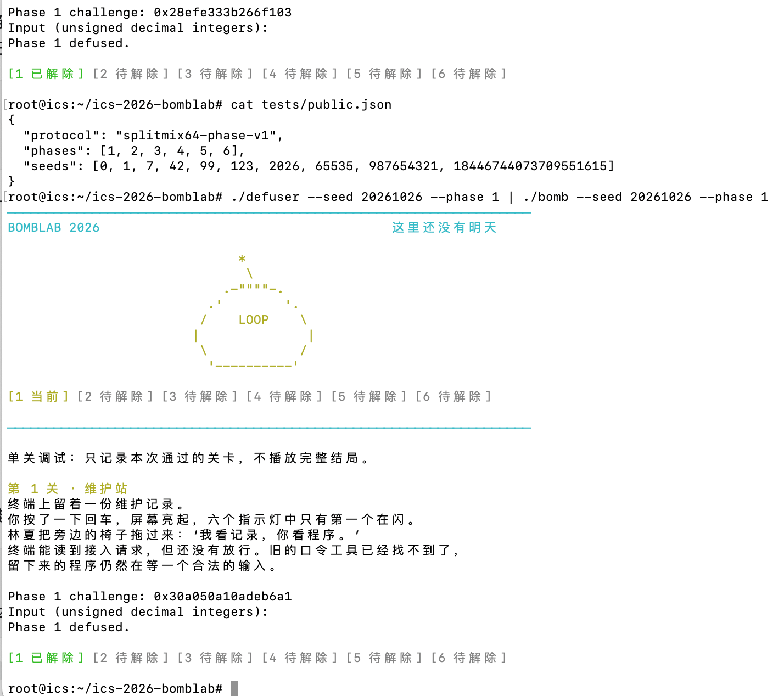
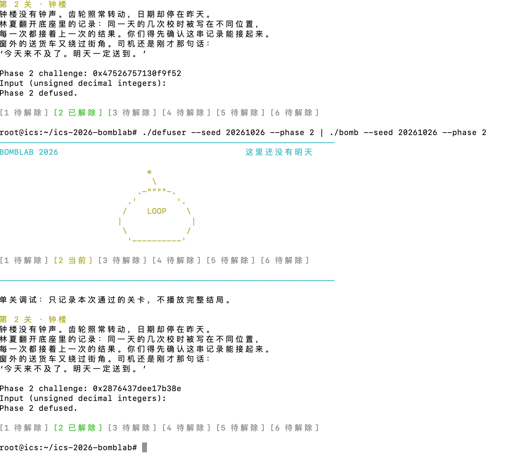
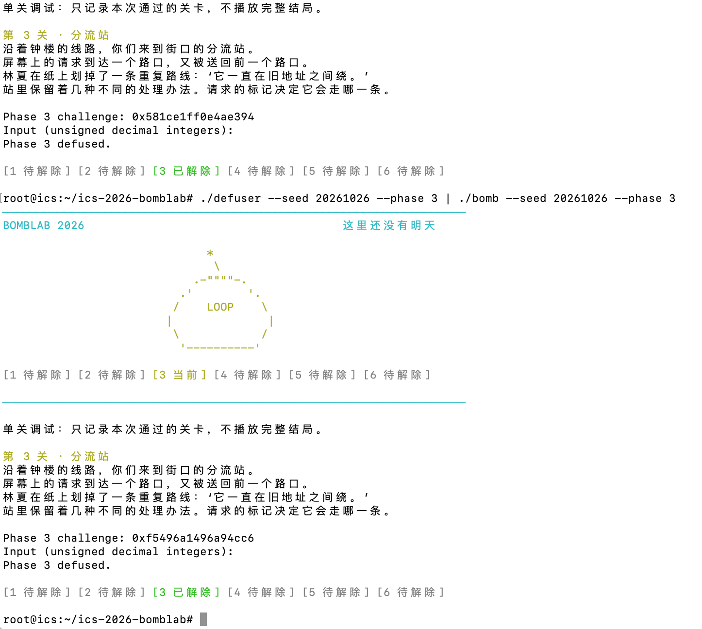
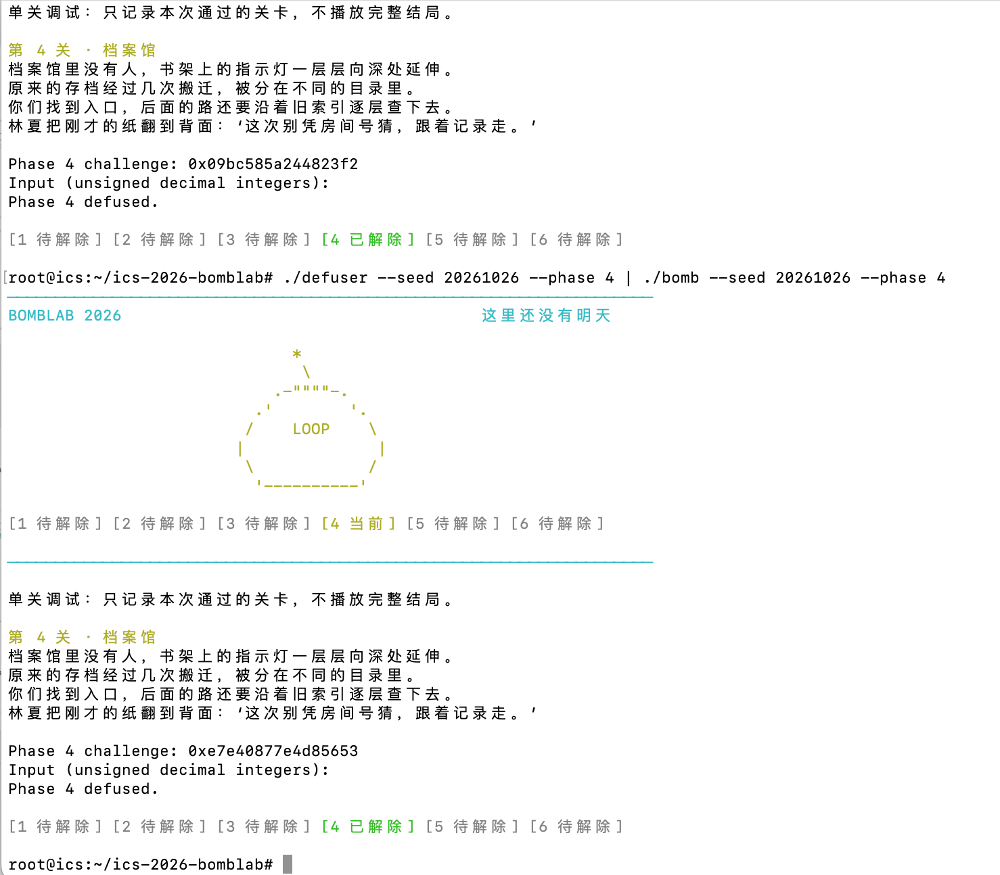
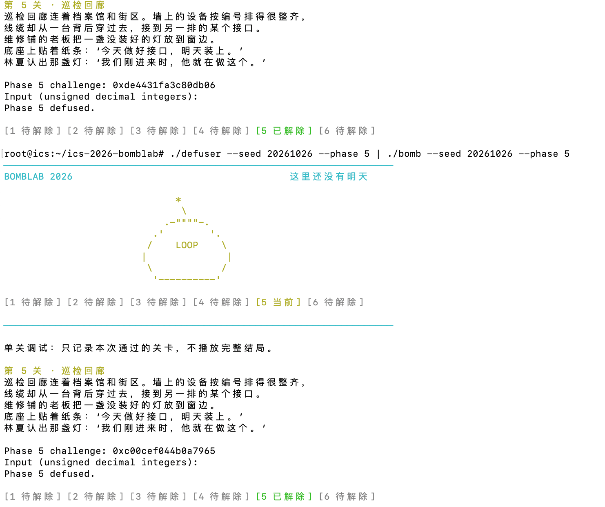
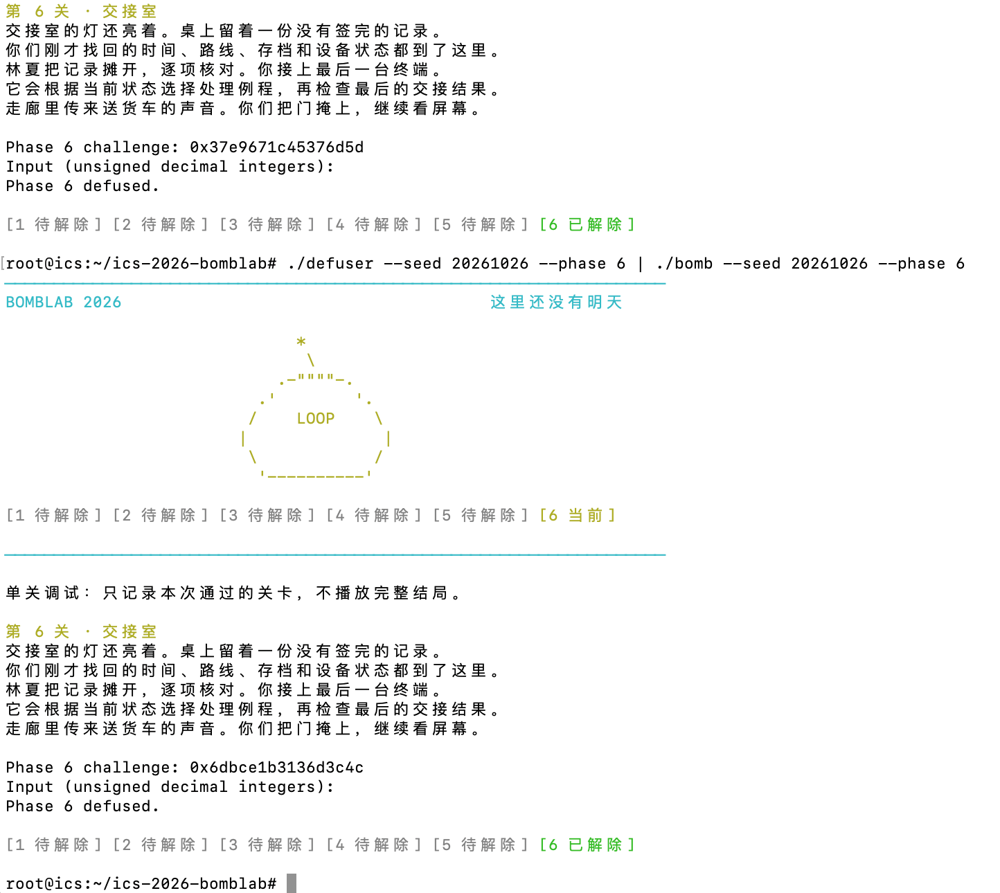
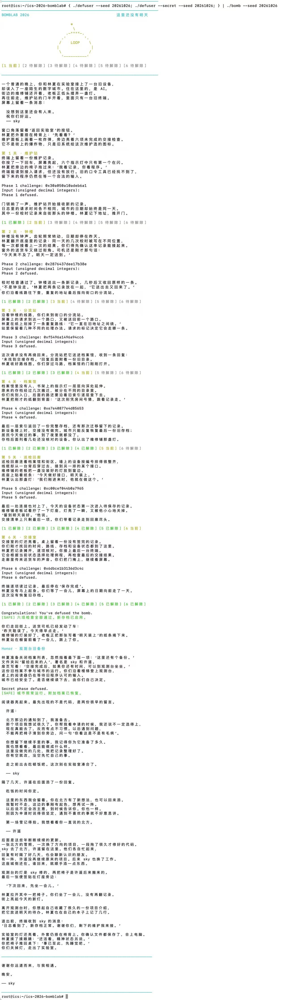
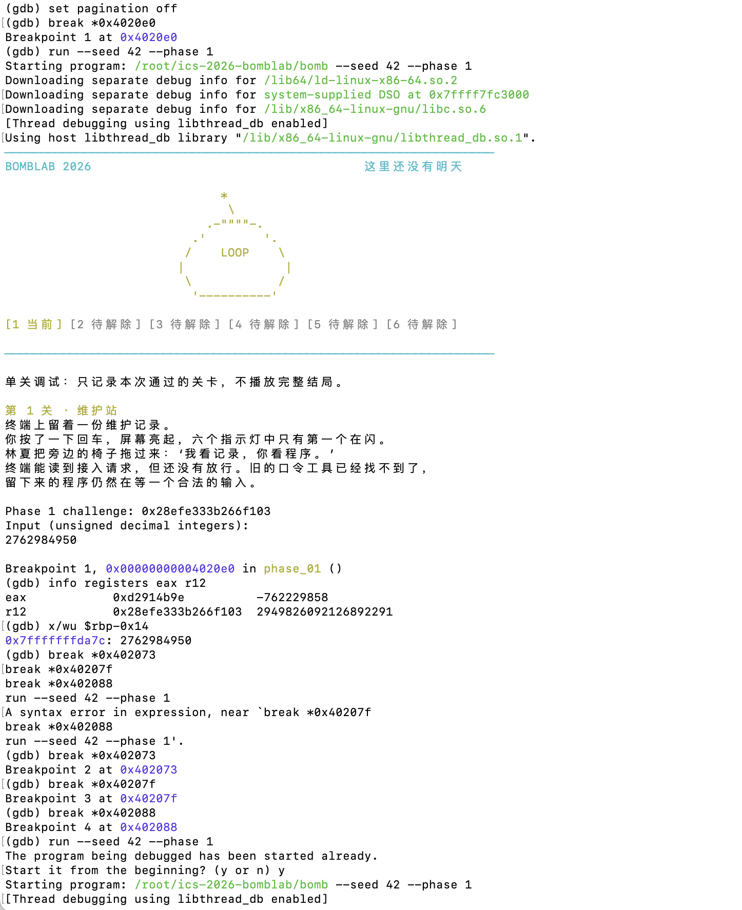
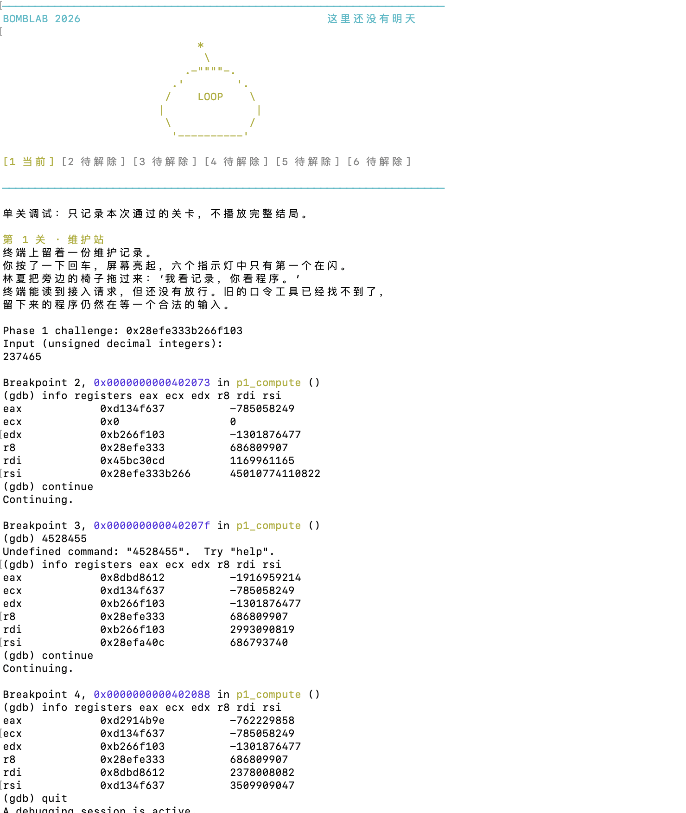

# Lab2: BombLab 实验报告

## 实验信息

- 实验：ICS Lab2 BombLab
- 完成日期：2026-10-26
- 环境：Ubuntu 24.04.5 LTS，Linux 6.8.0-57-generic x86_64；GCC 13.3.0（Ubuntu 13.3.0-6ubuntu2~24.04.1）；GNU GDB 15.1（Ubuntu 15.1-1ubuntu1~24.04.1）
- 解法文件：`defuser.c`

## 实验目标与方法

本实验通过分析个人炸弹程序的汇编，恢复每一关从 `challenge` 到输入口令的计算关系，并在 `defuser.c` 中实现可适用于不同 seed 的求解函数。分析时使用只读反汇编和调试观察，没有通过 GDB 修改炸弹内部变量、寄存器或内存来绕过检查。

## Phase 1

### 关键汇编与推理

- 关键函数/地址：`phase_01` `0x402090`；`p1_compute` `0x402050`；`p1_step0` `0x402020`、`p1_step1` `0x402030`、`p1_step2` `0x402040`。
- 参数传递、调用顺序和返回值观察：`phase_01` 将第二个参数 `challenge` 保存在 `r12` 中。解析输入后，它将 `r12` 放入 `rdi`，调用 `p1_compute`。计算函数依次调用 `p1_step1`、`p1_step0`、`p1_step2`，最终结果留在 `eax`；`phase_01` 将其与解析出的整数比较，并通过 `sete al` 返回比较结果。
- 从关键指令还原出的计算步骤：令 `hi` 为 `challenge >> 32` 的低 32 位，`mid` 为 `challenge >> 16` 的低 32 位，`lo` 为 `challenge` 的低 32 位。`p1_step1(hi, mid)` 先算 `hi - mid`，乘 3 后加 `0x63D0`；`p1_step0(lo, hi)` 将 `hi` 与 `0x473F` 异或，再加 `2 * lo`；`p1_step2(step0, step1)` 计算 `step0 + 4 * step1`，再与 `0x1570` 异或。`lea` 在这里用于算术组合，不是内存读取。中间和最终算术结果均按 32 位无符号值保留低 32 位。
- 最终口令字段数量：1 个无符号整数。

### 验证

- 非公开 seed：`20261026`
- 运行命令：`./defuser --seed 20261026 --phase 1 | ./bomb --seed 20261026 --phase 1`
- 结果：`Phase 1 defused.`
- 截图：

## Phase 2

### 关键汇编与推理

`phase_02` 从 `0x4020f0` 开始。函数先调用 `valid_u32_fields` 检查输入字段数，再用 `sscanf` 解析六个无符号整数。输入字符串保存在 `r12`，challenge 保存在 `r13`；六个解析值依次位于 `[rbp-0x40]`、`[rbp-0x3c]`、`[rbp-0x38]`、`[rbp-0x34]`、`[rbp-0x30]`、`[rbp-0x2c]`。

设口令字段为 `x0` 到 `x5`。第一项由 challenge 右移 9 位、取低 6 位后再加 `0x1B` 得到：

`x0 = ((challenge >> 9) & 0x3F) + 0x1B`

之后循环下标 `i` 从 1 到 5。汇编用 `i + 12` 作为移位量，从 challenge 取出 6 位得到 `b`，将 `b + i` 与前一项 `x[i-1]` 异或，再乘以 5，得到当前项：

`b = (challenge >> (i + 12)) & 0x3F`

`xi = uint32((x[i-1] ^ (b + i)) * 5)`

其中 `lea eax, [rax+rax*4]` 实现乘 5；写入 `eax` 的结果按 32 位保留。每轮计算出的当前项都与对应输入字段比较，全部匹配后函数返回成功。这里的位移在 64 位 challenge 上执行，随后通过 `and eax, 0x3f` 取低 6 位。

- 参数传递、调用顺序和返回值观察：`r12` 保存输入行地址，`r13` 保存 64 位 `challenge`，在解析与计算期间继续使用。`sscanf` 将六个无符号整数写入栈上的六个位置；解析数量不是 6 时进入失败路径。解析成功后，程序根据 `challenge` 计算六个期望值，并逐项与栈上的输入比较。任一项不匹配时返回 `0`，六项全部匹配时返回 `1`。
- 最终口令字段数量：6 个无符号整数。

### 验证

- 非公开 seed：`20261026`
- 运行命令：`./defuser --seed 20261026 --phase 2 | ./bomb --seed 20261026 --phase 2`
- 结果：`Phase 2 defused.`
- 截图：

## Phase 3

### 关键汇编与推理

- 关键函数/地址：`phase_03` `0x402290`；`p3_dispatch` `0x402230`；分支函数 `p3_case_0`–`p3_case_7`（`0x4021a0`–`0x402220`）；跳转表 `0x405820`。
- 参数传递、调用顺序和返回值观察：调用 `p3_dispatch` 前，`mov edi, r12d` 和 `and edi, 7` 将 challenge 低 32 位的低 3 位放入 `edi`，作为分发表索引。第二个参数由 `rsi` 计算，为 `(uint32_t)(challenge >> 3) ^ (uint32_t)(challenge >> 32)`。返回后，`cmp DWORD PTR [rbp-0x14], eax` 将返回值与 `sscanf` 保存的第二项比较；调用前，第一项已与索引比较。
- 索引为 `challenge` 低 32 位与 `7` 按位与的结果。第二个分发参数 `x` 为 `(uint32_t)(challenge >> 3) ^ (uint32_t)(challenge >> 32)`。跳转表中索引与 case 的对应关系及分支运算如下；所有分支算术结果均按 32 位保留：

| 索引 | 分支 | 计算结果 |
|---:|---|---|
| 0 | `p3_case_7` | `(2 * x) ^ 0x96C8` |
| 1 | `p3_case_3` | `(x ^ 0x01BA) + (x >> 1)` |
| 2 | `p3_case_1` | `(2 * x) ^ 0x718F` |
| 3 | `p3_case_6` | `3 * x + 0x600E` |
| 4 | `p3_case_2` | `5 * x + 0x1CFB6` |
| 5 | `p3_case_0` | `3 * x + 0xFBEF` |
| 6 | `p3_case_5` | `(x ^ 0x9315) + (x >> 2)` |
| 7 | `p3_case_4` | `5 * x + 0x45C59` |

`phase_03` 先将输入第一项与索引比较，再将分支返回值与输入第二项比较。
- 最终口令字段数量：2 个无符号整数。

### 验证

- 非公开 seed：`20261026`
- 运行命令：`./defuser --seed 20261026 --phase 3 | ./bomb --seed 20261026 --phase 3`
- 结果：`Phase 3 defused.`
- 截图：

## Phase 4

### 关键汇编与推理

- 关键函数/地址：`phase_04` `0x402380`；递归函数 `p4_walk` `0x402310`。
- 参数传递、调用顺序和返回值观察：`phase_04` 将 challenge 派生的目标、下界 `0`、上界 `127` 和辅助值作为四个 32 位参数传给 `p4_walk`，对应 `edi`、`esi`、`edx`、`ecx`。递归函数最终把结果放在 `eax`；关卡入口将其与解析出的唯一整数比较，通过 `sete al` 返回比较结果。
- 递归函数各参数的含义：`edi` 是目标值，`esi` 和 `edx` 分别是区间下界和上界，`ecx` 是递归中保留使用的辅助值。
- challenge 低 7 位作为目标值，初始区间为 `[0, 127]`。辅助值 `salt` 为 `(uint32_t)(challenge >> 7) ^ (uint32_t)(challenge >> 32)`。中点计算为 `low + ((high - low) >> 1)`。`cmp edi, eax` 后的 `je` 表明目标等于中点时直接走基例返回；若不相等，`cmp eax, edi` 后的 `jb` 表示目标小于中点时进入左区间 `[low, mid - 1]`，否则目标大于中点并进入右区间 `[mid + 1, high]`。
- 基例返回 `(mid + 0x85) ^ salt`。递归返回后先计算 `5 * result`，再与 `mid + salt` 异或；左分支再异或 `0x13`，右分支再异或 `0x1D`。因此左右分支分别为 `uint32(((5 * result) ^ (mid + salt)) ^ 0x13)` 和 `uint32(((5 * result) ^ (mid + salt)) ^ 0x1D)`。其中 `lea eax,[rax+rax*4]` 实现乘 5，写入 `eax` 的算术结果保留低 32 位。
- 最终口令字段数量：1 个无符号整数。

### 验证

- 非公开 seed：`20261026`
- 运行命令：`./defuser --seed 20261026 --phase 4 | ./bomb --seed 20261026 --phase 4`
- 结果：`Phase 4 defused.`
- 截图：

## Phase 5

### 关键汇编与推理

- 关键函数/地址：`phase_05` `0x402460`；遍历函数 `p5_traverse` `0x402400`；头指针表 `p5_heads` `0x405b60`；节点区 `p5_nodes` `0x405ba0`。
- 参数传递、调用顺序和返回值观察：`sscanf` 的第一个输出地址放在 `rdx`，对应 `[rbp-0x1c]`；第二个输出地址放在 `rcx`，对应 `[rbp-0x18]`。调用 `p5_traverse` 时，`rdi` 是 challenge，`rsi` 是输出位置 `[rbp-0x14]` 的地址。返回后，`mov edx, eax` 保存遍历返回值，随后 `cmp [rbp-0x1c], edx` 比较第一项与返回值；若相等，再将指针输出读入 `eax`，用 `cmp [rbp-0x18], eax` 比较第二项与指针输出。
- 节点由 64 位 `next` 指针和两个 32 位字段组成：偏移 `+0` 是 `next`，`+8` 是 `value`，`+0xC` 是 `tag`。`p5_heads` 是 8 项头指针表，索引为 `challenge & 7`；遍历步数为 `(challenge >> 3) & 3`，每一步沿 `next` 前进一次。
- 初始累积值为 `(((uint32_t)(challenge >> 6) ^ (uint32_t)(challenge >> 32) ^ tag ^ 0x3625) + value)`。之后每到一个节点，先将累积值与该节点的 `tag` 异或，再加该节点的 `value`。累积值运算按 32 位保留。函数返回最终累积值，并通过第二个参数指向的地址写出最终节点的 `value`；`phase_05` 将返回值与输入第一项比较，再将指针输出字段与输入第二项比较。
- 最终口令字段数量：2 个无符号整数。

### 验证

- 非公开 seed：`20261026`
- 运行命令：`./defuser --seed 20261026 --phase 5 | ./bomb --seed 20261026 --phase 5`
- 结果：`Phase 5 defused.`
- 截图：

## Phase 6

### 关键汇编与推理

- 关键函数/地址：`phase_06` `0x402590`；分发函数 `p6_dispatch` `0x402540`；操作函数 `p6_op_0`–`p6_op_5`（`0x4024d0`、`0x4024e0`、`0x402500`、`0x402510`、`0x402520`、`0x402530`）；函数指针表 `p6_ops` `0x405e00`。
- 参数传递、调用顺序和返回值观察：`phase_06` 将保存的 64 位 challenge 放入 `rdi` 并调用 `p6_dispatch`。分发函数返回值位于 `eax`，关卡将它与解析出的唯一整数比较，并用 `sete al` 返回比较结果。
- `p6_ops` 位于 `0x405E00`，表项映射为：索引 0→`p6_op_0`、1→`p6_op_1`、2→`p6_op_4`、3→`p6_op_2`、4→`p6_op_2`、5→`p6_op_5`、6→`p6_op_1`、7→`p6_op_3`。第一次调用的索引是 `challenge & 7`，输入是 `(uint32_t)(challenge >> 6) ^ (uint32_t)(challenge >> 32)`。第一次返回值与 `0xC596` 异或后作为第二次调用输入；第二次表项的字节偏移为 `challenge & 0x38`，等价索引为 `(challenge & 0x38) >> 3`。第二次返回值加 `0xBF1D` 后成为 `p6_dispatch` 的返回值。
- 各操作函数的具体运算：设输入为 32 位无符号数 `x`。`p6_op_0` 计算 `(x ^ 0x7AD2) + 4*x`；`p6_op_1` 计算 `(32*x + 0x6D1C) ^ 5*x`；`p6_op_2` 计算 `ROL32(x, 1) ^ 0x78B8`；`p6_op_3` 计算 `ROR32(x, 2)`；`p6_op_4` 计算 `(x ^ (x >> 1)) + 0xE3D2`；`p6_op_5` 计算 `(x + 0x836F) ^ (x >> 3)`。每个函数将结果写入 `eax`，因此加法、乘法、异或以及逻辑移位后的结果均按 32 位保留低 32 位；`rol` 和 `ror` 是 32 位循环旋转。
- 最终口令字段数量：1 个无符号整数。

### 验证

- 非公开 seed：`20261026`
- 运行命令：`./defuser --seed 20261026 --phase 6 | ./bomb --seed 20261026 --phase 6`
- 结果：`Phase 6 defused.`
- 截图：

## Honor

### 关键汇编与推理

- 关键函数/地址：`secret_phase` `0x402610`；`secret_copy` `0x4026d0`；`secret_gate` `0x4026f0`；调用点 `main` `0x401648`。
- 参数传递、调用顺序和返回值观察：调用点向 `secret_gate` 传入字符串指针、challenge 和 context，分别位于 `rdi`、`rsi`、`rdx`。gate 将后两个值保存到 `r13`、`r14`，检查并复制字符串后，把偏移 `0x24` 处的字符串地址作为 `secret_phase` 的第一个参数，再把保存的 challenge 和 context 作为第二、第三个参数。gate 将 `secret_phase` 的返回值原样交回驱动；长度或标记检查失败时返回 `0`。
- `secret_gate` 计算输入行长度并要求长度在 36 到 163 字节之间；复制字符串后检查偏移 `0x20` 处的四字节标记 `OPEN`，再将偏移 `0x24` 处的字符串交给 `secret_phase`。因此完整输入行由 32 字节前缀、`OPEN` 和后续文本组成。复制函数逐字节复制，并包含 NUL 终止符。
- `secret_phase` 解析三个无符号整数。第一项为 `context & 3`。令 `c_mix = (uint32_t)(challenge >> 32) ^ (uint32_t)challenge`，`t_mix = (uint32_t)(context >> 32) ^ (uint32_t)context`，`selector = context & 3`，`mix_input = c_mix ^ t_mix`。`secret_mix(v) = ((v >> 1) ^ 0x9FA0) + (v ^ 0x82D3)`。第二项为 `secret_mix(mix_input) ^ (selector * 0x82D3) ^ (uint32_t)(context >> 16)`；第三项为 `第二项 ^ (t_mix + selector + 0x9FA0 + (c_mix >> 1))`。这些中间值均按 32 位无符号结果处理。
- 输出是一行非空、NUL 终止且不含换行符的文本；实现需在 `cap` 范围内写出完整行。当前解法的布局为 32 个 `X`、`OPEN`，再跟三个以空格分隔的整数。
- 最终口令字段数量：一行非空文本，不是固定数量的整数。

### 验证

- 非公开 seed：`20261026`
- 运行命令：`{ ./defuser --seed 20261026; ./defuser --secret --seed 20261026; } | ./bomb --seed 20261026`
- 结果：六个常规关卡全部解除，显示 `Secret phase defused.`
- 截图：

## 测试汇总

公开测试使用 `python3 public_test.py`。本次记录结果：

- Phase 1–6：60/60 PASS
- Honor：10/10 PASS

非公开 seed 验证记录：

| 关卡 | 非公开 seed | 验证命令/方式 | 结果 | 截图 |
|---|---:|---|---|---|
| Phase 1 | `20261026` | `./defuser --seed 20261026 --phase 1 | ./bomb --seed 20261026 --phase 1` | `Phase 1 defused.` | `images/phase1.png` |
| Phase 2 | `20261026` | `./defuser --seed 20261026 --phase 2 | ./bomb --seed 20261026 --phase 2` | `Phase 2 defused.` | `images/phase2.png` |
| Phase 3 | `20261026` | `./defuser --seed 20261026 --phase 3 | ./bomb --seed 20261026 --phase 3` | `Phase 3 defused.` | `images/phase3.png` |
| Phase 4 | `20261026` | `./defuser --seed 20261026 --phase 4 | ./bomb --seed 20261026 --phase 4` | `Phase 4 defused.` | `images/phase4.png` |
| Phase 5 | `20261026` | `./defuser --seed 20261026 --phase 5 | ./bomb --seed 20261026 --phase 5` | `Phase 5 defused.` | `images/phase5.png` |
| Phase 6 | `20261026` | `./defuser --seed 20261026 --phase 6 | ./bomb --seed 20261026 --phase 6` | `Phase 6 defused.` | `images/phase6.png` |
| Honor | `20261026` | `{ ./defuser --seed 20261026; ./defuser --secret --seed 20261026; } \| ./bomb --seed 20261026` | `Secret phase defused.` | `images/honor.jpg` |

## 工具与资料

- `objdump`、`nm`：查看个人炸弹的符号、反汇编和跳转表/只读数据。
- GDB：只读观察寄存器、内存和程序执行过程；未使用命令修改炸弹状态以绕过检查。
- `make`、`public_test.py`、个人 `bomb`：编译并验证求解器。
- ChatGPT：用于解释汇编与 C 语言语义、讨论调试步骤和检查验证思路。工具提供的建议经过本人对照个人炸弹、实现和测试结果核验。

## Phase 1 调试过程

Phase 1 的第一次实现没有通过。seed 42 时，解法输出 `2762984950`，但在 `phase_01` 的比较位置观察到炸弹计算出的期望值是 `0xd2914b9e`，说明问题在解法计算而非输入格式。复查 `p1_step1` 时，我发现最初把 `lea eax, [rdi+rdi*2+0x63d0]` 看成了差值直接加常数，漏掉了 `rdi + 2*rdi` 所表示的乘 3；而 `rdi` 此前已经是 `hi - mid`。因此这一步应先将差值乘 3，再加 `0x63d0`。

为定位错误，我在 `phase_01` 的比较位置和 `p1_compute` 的几个调用返回位置设置断点，只读取寄存器及栈上的输入值，没有修改炸弹状态。对同一 challenge 的跟踪中，依次观察到 `p1_step1` 返回 `0xd134f637`、`p1_step0` 返回 `0x8dbd8612`，最终 `p1_compute` 返回 `0xd2914b9e`。我据此修正计算关系、重新编译并再次运行，Phase 1 随后通过；之后也用非公开 seed `20261026` 验证通过。这个过程说明，单次输出不匹配时，应沿调用链比较中间值，逐条核对汇编表达式，而不是只根据最终结果猜测。

下面两张截图分别记录了输入与期望值不符的比较现场，以及在 `p1_compute` 中逐步检查中间返回值的过程：

## 实验总结

我完成了 Phase 1–6 和 Honor 的求解实现。公开测试记录为常规关卡 `60/60`、Honor `10/10`；另用不在公开列表中的 seed `20261026` 验证了六个常规关卡和 Honor，运行结果均通过，证据见上表和截图。Phase 1 的调试经历让我认识到，反汇编中的寻址表达式也可能表示算术运算；遇到结果不符时，沿函数调用设置断点并检查中间值，有助于定位具体的计算步骤错误。
